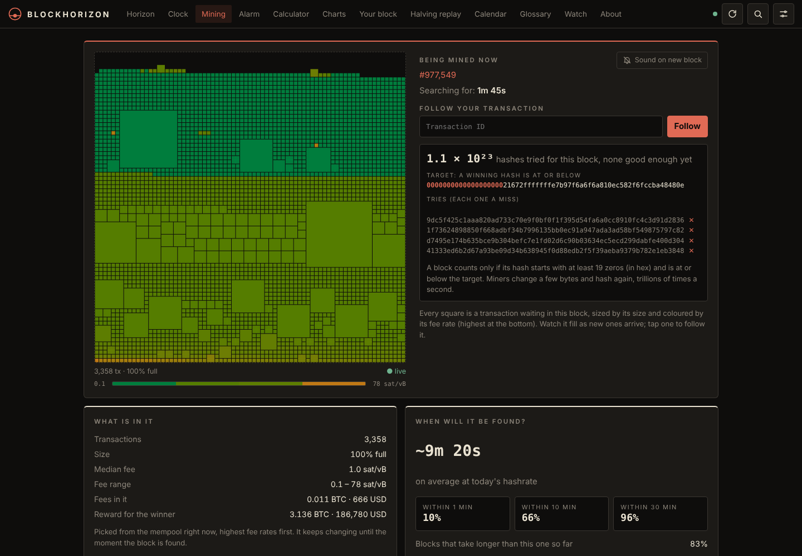
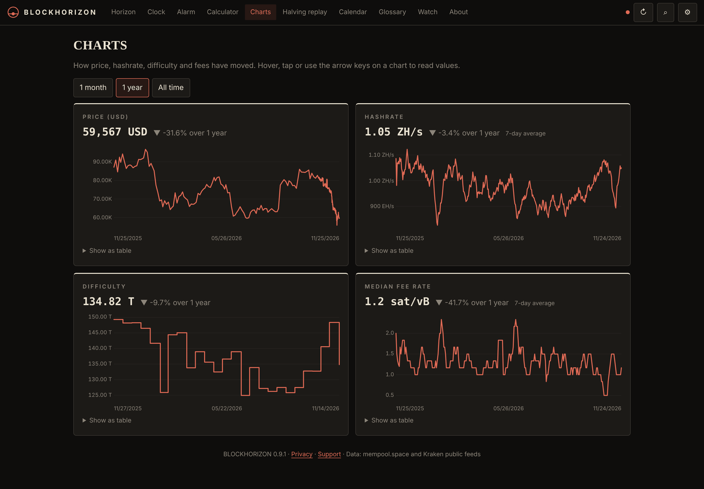
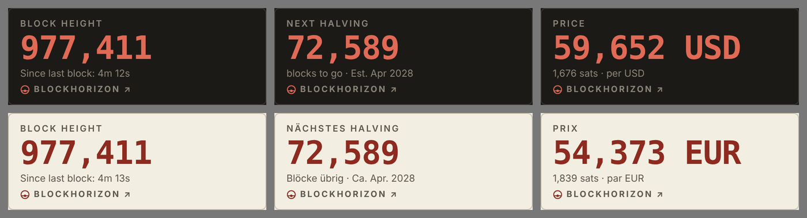
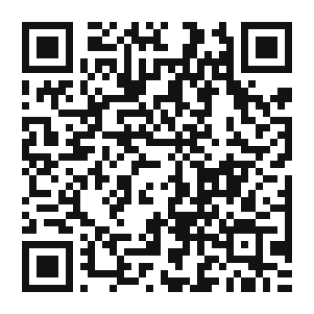

# BLOCKHORIZON

**A calm, live Bitcoin dashboard where time is measured in blocks.**

### [→ Open the app](https://random21m.github.io/BLOCKHORIZON/)

No accounts, no ads, no tracking, nothing to install (though you can). Free public data, in 38 languages, and it works offline.

[](https://github.com/Random21m/BLOCKHORIZON/stargazers)
[](https://github.com/users/Random21m/packages/container/package/blockhorizon) ([how many use it](#how-many-use-it))


When a block is mined, you see it happen: the blocks glide one slot along and the new one slides in.




| On a phone | History charts | On your own site |
|---|---|---|
|  |  |  |

## What it shows

BLOCKHORIZON is built around one idea: in Bitcoin, time is measured in blocks. The block height counts up; everything else counts down to the next block.

**The dashboard** (everything on one screen, no scrolling)
- Live block height, time since the last block, and the price streamed from Kraken (from Coinbase while Kraken is down), with the 24 h change
- Next halving (blocks to go, estimated date, reward) and supply issued
- Difficulty adjustment (progress, expected and previous change), hashrate with 7/14/30/90-day averages, block production against the 10-minute target
- Last block with its mining pool, fees, mempool (count, depth, inflow), and the projected and recent blocks, coloured like mempool.space
- Sats per unit in 7 currencies, Moscow time, market cap, Lightning network capacity
- Make it yours: hide the tiles you do not need and put the rest in your own order (**Settings, Dashboard**)

**More pages**
- **Mining:** watch the next block being built and mined, live. Every waiting transaction in it is a square, sized by its size and coloured by its fee rate; new ones drop in as they arrive, and when the block is found it turns purple and slides away while the next one starts to fill. Beside it: hashes tried so far, a stream of tries against the target, the chance it is found in the next minutes, what is in it (fees, reward) and which pool is likely to find it. Follow your own transaction: paste its ID (or tap its square, or use the link on its transaction page) and it is outlined in the block, with where it stands, until the moment it is mined. A bell button turns on the sound for each block found. Below: who is likely to find it, what miners earned over the last day (revenue, the part from fees, and the hashprice: what one PH/s earns a day), the mining pools ranked by blocks found over 24 hours to a year (share and estimated hashrate), and every past difficulty adjustment with how much it changed
- **Your block:** pick a day that matters (a birthday, your first bitcoin) and see the block mined that day, how many blocks have passed since, the next milestone, the reward and price back then, and save it as an image or share it on Nostr (signed by your Nostr browser extension, or copied for your Nostr app)
- **Clock:** just the height, time since the last block and the price, as large as the screen allows, plus a live countdown to the final bitcoin block (6,929,999, around 2140), with the screen kept awake (for a spare screen or an old tablet; see [On a spare screen](#on-a-spare-screen) for kiosk and e-ink displays)
- **Charts:** a live trading chart: BTC candlesticks from Kraken in your currency, 1 minute to 1 week candles, the newest moving with every trade. Volume, EMA 20, SMA 50, SMA 200, Bollinger Bands, RSI and MACD; a crosshair with open, high, low and close; horizontal and trend lines (kept per currency, moved by dragging or with the arrow keys); price alerts set by clicking the chart; the live order book (checked against Kraken's checksum) and recent trades beside it; zoom and scroll by mouse, touch or keyboard; full screen. Below it: price, hashrate, difficulty, median fee, fees per block, the fees' share of miner income and block size over 1 month, 1 year or all time; the mempool over time split by fee rate (24 hours to all time), with the fee rate the next block needs and how often it was fuller than now, to see whether now is a good time to send; and seven long-term charts: the 200-week average, the Mayer Multiple, the Puell Multiple, the halving cycles side by side, the supply issued over time, the hash ribbons and the difficulty ribbon
- **Charts:** a live trading chart: BTC candlesticks from Kraken in your currency, 1 minute to 1 week candles, the newest moving with every trade. Volume, EMA 20, SMA 50, SMA 200, Bollinger Bands, RSI and MACD; a crosshair with open, high, low and close; horizontal and trend lines (kept per currency, moved by dragging or with the arrow keys); price alerts set by clicking the chart; the live order book (checked against Kraken's checksum) and recent trades beside it; zoom and scroll by mouse, touch or keyboard; full screen. Below it: price, hashrate, difficulty and median fee over 1 month, 1 year or all time; the mempool over time split by fee rate (24 hours to all time), with the fee rate the next block needs and how often it was fuller than now, to see whether now is a good time to send; price and supply facts (the all-time high, how far below it and since when, yearly inflation now and after the next halving) and seven long-term charts: the 200-week average, the Mayer Multiple, the Puell Multiple, the halving cycles side by side, the supply issued over time, the hash ribbons and the difficulty ribbon
- **Alarm:** a sound and a message when the chain reaches a block height, when bitcoin reaches a price, or when fees drop to your limit (with a system notification in the background, if you allow it). On your own node it can also send them to your phone through ntfy while no browser has the app open, and watch your own addresses: a message when a payment to one of them is seen, and again when it is confirmed (only on a node, because the public site would have to send your addresses to mempool.space)
- **Calculator:** sats ⇄ fiat, block height ⇄ date, and what a payment costs right now at each fee level
- **Search:** any block by height or date (with a picture of what was in it and all its transactions, 25 at a time), any address (balance and recent payments), any transaction by ID (confirmations, fee, or its place in the queue; every input and output with its address and amount; and what it gives away about privacy, worked out on your device), with shareable links; for a waiting transaction, an alert when it confirms (on your own node, on your phone too), and if its fee is too low, what you can do about it and what it would cost
- Halving replay, chain calendar, glossary, and a Watch page of Bitcoin channels

**Everywhere**
- Your own node: point it at your own mempool server (**Settings, Data**), or run it on your node with the container (see [packaging](packaging/README.md)). If the data server stops answering, the height, blocks, fees and mempool come from blockstream.info until it is back, and the connection dot turns amber
- On a phone, the four main pages sit in a tab bar along the bottom, the rest under **More**
- Dark, light or automatic; English, German, Spanish, French, Portuguese (Portugal and Brazil), Italian, Dutch, Polish, Czech, Slovenian, Croatian, Swedish, Danish, Norwegian, Finnish, Hungarian, Romanian, Greek, Lithuanian, Turkish, Indonesian, Vietnamese, Thai, Malay, Russian, Ukrainian, Macedonian, Georgian, Hindi, Nepali, Bengali, Japanese, Korean, Simplified Chinese, Arabic, Persian and Hebrew (chosen from your browser's language at first); your currency, time and date format
- Accessible: keyboard-friendly, screen-reader labels, and checked with axe-core on every page in both themes as part of the tests
- Calm by design: flat, no flashing, no glow, and nothing moves if you turn on reduce motion

## Install it as an app

Open https://random21m.github.io/BLOCKHORIZON/ and you are already using it. Installed, it opens in its own window, works offline with the last values it saw, and updates itself. Long-press its icon for shortcuts to Clock, Alarm, Charts and Search.

| Where | How |
|---|---|
| **iPhone / iPad (Safari)** | Tap the Share button, then **Add to Home Screen**, then **Add**. |
| **Android (Chrome)** | Tap the menu (three dots), then **Install app** (or **Add to Home screen**). |
| **Windows / Mac / Linux (Chrome or Edge)** | Click the install icon at the right end of the address bar, or open the menu and choose **Install BLOCKHORIZON**. |
| **Mac (Safari 17 or newer)** | **File**, then **Add to Dock**. |
| **Firefox on desktop** | Firefox cannot install web apps. Bookmark the page instead; everything else works. |

Settings (currency, language, time format, theme, sounds) are kept only in your own browser. To remove the app, uninstall it like any other app or clear the site data.

## On a spare screen

Clock mode makes any screen a block clock: an old tablet, a monitor on the wall, or a Raspberry Pi with a small
display. Two options in the link set it up for a screen that stays on:

| Link | For |
|---|---|
| `…/#/clock?kiosk` | A screen nobody touches: no close button or mouse pointer, a note if no new data has arrived for 30 minutes, and a fresh reload every 6 hours. |
| `…/#/clock?kiosk&eink` | An e-ink display: black on white, nothing animated, and text that changes only by the minute (e-ink redraws slowly). |

On your own node, use its address (for example `http://umbrel.local:3027/#/clock?kiosk`) so the clock reads your node.
Open the app once in the same browser first to choose your currency and language; the clock keeps them.

**Raspberry Pi, step by step** (Raspberry Pi OS with desktop):
1. In **Raspberry Pi Configuration**, under **Display**, turn **Screen Blanking** off.
2. Make the browser open the clock full screen at start-up. On the current desktop (labwc), add this line to
   `~/.config/labwc/autostart` (create the file if needed), with your link:
   ```
   chromium --kiosk --noerrdialogs --disable-infobars "https://random21m.github.io/BLOCKHORIZON/#/clock?kiosk" &
   ```
   On older systems the command is `chromium-browser`, and the desktop may be Wayfire: there, the same command goes
   in `~/.config/wayfire.ini` under `[autostart]`, as `bh = chromium-browser --kiosk …`.
3. Restart. To leave the clock, press Escape or switch window with Alt+Tab.

## Put it on your site

Show the live block height, the halving countdown or the price on your own website or blog with one line of HTML. In the app, open **About → Embed on your site**, pick what to show, and copy the code. For example:

```html
<iframe src="https://random21m.github.io/BLOCKHORIZON/embed.html?show=height" width="320" height="120" style="border:0" title="BLOCKHORIZON: Block height" loading="lazy"></iframe>
```

Options: `show=height|halving|price|mining` (`mining` draws a small picture of the block being mined; give it `height="150"`), `theme=auto|dark|light`, `lang=en|de|es|fr|pt|pt-BR|it|nl|pl|cs|sl|hr|sv|da|nb|fi|hu|ro|el|lt|tr|id|vi|th|ms|ru|uk|mk|ka|hi|ne|bn|ja|ko|zh|ar|fa|he`, and `cur=USD|EUR|GBP|CAD|CHF|AUD|JPY` for the price. The widget updates itself and links back to the app.

## Privacy

Your browser asks the public mempool.space API (or the server you chose in Settings) for block, fee and mempool data, blockstream.info only while that server is not answering, and Kraken's public feed for the price (plus Kraken's public API for past candles on the trading chart). Only while Kraken sends no price for 15 seconds, the price comes from Coinbase's public feed instead (US dollars, euros and pounds; the other currencies from mempool.space), until Kraken is back. Nothing else is contacted, there are no cookies or analytics, and nothing about you is stored anywhere but your own browser. Details: [privacy.html](https://random21m.github.io/BLOCKHORIZON/privacy.html).

## Run your own copy

There is nothing to build: the site is plain static files, so any static host works (served over HTTPS, or from `localhost`, so the offline mode can start).

- **On your computer:** clone this repository, run `python3 -m http.server 8080` in it, and open http://localhost:8080.
- **On GitHub Pages:** fork the repository, open **Settings, Pages** and set **Source** to **GitHub Actions**. The included workflow publishes the site on every push to `main` (you can also start it from the **Actions** tab).
- **On Umbrel or StartOS:** submitted to both app stores ([Umbrel](https://github.com/getumbrel/umbrel-apps/pull/6425), [StartOS package](https://github.com/Random21m/blockhorizon-startos)); there it reads all chain data from your node's Mempool.
- **On your node (Docker):** `docker build -t blockhorizon . && docker run -p 8080:80 -e MEMPOOL_URL=http://<node>:<port> blockhorizon` serves the app and passes `/api` through to your node's mempool, so your browser talks only to your node (and Kraken for the price). See [packaging/README.md](packaging/README.md) for the published image and the Umbrel app.
- **Anywhere else:** upload `index.html`, `embed.html`, `embed.css`, `style.css`, `sw.js`, `manifest.webmanifest`, `privacy.html`, `config.json`, `.nojekyll` and the `icons`, `src` and `docs` folders. Paths are relative, so a sub-folder works too.
- **Link previews:** the preview card tags in `index.html` (`og:url`, `og:image`, `canonical`) point at this site's address; change them to yours in a fork.

## Develop and test

```
node --test tests/lib.test.mjs     # unit tests on recorded API responses (tests/fixtures)
node tests/smoke.mjs               # Playwright browser checks with the API mocked
python3 -m http.server 8080        # then open http://localhost:8080
node tests/screenshots.mjs         # remake the pictures in docs/ from live data
node tests/push.mjs                # phone notifications server in nginx (needs nginx + libnginx-mod-http-js)
npx prettier@3.3.3 --write .       # format the code (CI checks it)
```

No build step and no dependencies. The accessibility check in the browser tests runs when `axe-core` is installed (`npm install --no-save axe-core`), as it is in CI.

Code layout (`src/`): `app.js` routing, live repaint and start-up · `state.js` settings and shared state · `data.js` data feeds, block alarms and fee alerts · `ui.js` tiles, charts and other building blocks · `view-dash.js` dashboard and clock · `view-chain.js` block and transaction pages · `view-tools.js` alarm and calculator · `view-info.js` replay, calendar, glossary, watch, about · `view-charts.js` history charts · `trade-chart.js`, `trade-side.js` the live trading chart, order book and trades · `view-my.js` Your block · `view-mining.js`, `block-scene.js` the Mining page and its live block picture · `arrival.js` the block arrival animation · `embed.js` the embeddable widget · `modals.js` search and settings · `lib.js` pure helpers (unit-tested) · `api.js`, `price.js` network (data server, backup source, Kraken and the backup price feed) · `nostr.js` sharing to Nostr · `i18n.js` and `lang/` (one file per language; only the chosen one is downloaded), `content.js`, `content-i18n.js` texts.

Version 0.21.0. What changed in each version: [CHANGELOG.md](CHANGELOG.md). Not built yet: an art gallery, conference listings and chain-state totals (addresses, UTXOs, disk size), for lack of a free, trustworthy public source.

## How many use it

Honestly, we do not know, and that is on purpose: the app has no analytics, so nobody counts visits to the website. The
only public numbers are these:

- **GitHub stars:** the badge at the top, updated by [shields.io](https://shields.io) from GitHub.
- **Container downloads** (Umbrel, StartOS and Docker): GitHub shows the total on the
  [package page](https://github.com/users/Random21m/packages/container/package/blockhorizon), under "Total downloads".
  There is no badge for it: neither GitHub nor shields.io offers one for this registry, and the third-party badges
  that exist work by scraping that page. Each update, reinstall or automatic check can count again, so it is an upper
  bound, not a number of people.

The badges are pictures on this README only, loaded by GitHub; the app itself contacts neither GitHub's statistics nor
shields.io.

## Support

If BLOCKHORIZON is useful to you, you can send a tip over Lightning:



`npub1vj8zjhnmkhekv93e2xmrz7kfwuxq25vrzw53u4dqhwd2lp5smvks3mwu2n@npub.cash`

(An npub.cash Lightning address: scan the QR code or paste the address into any Lightning wallet.)
