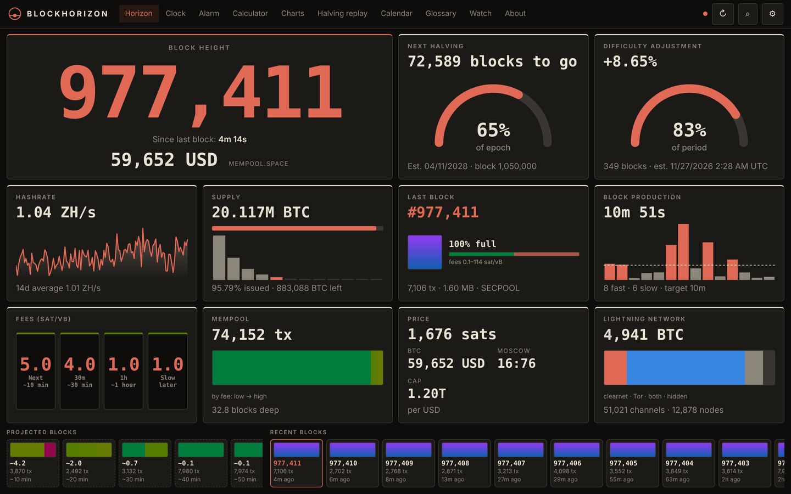
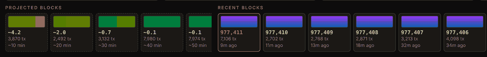
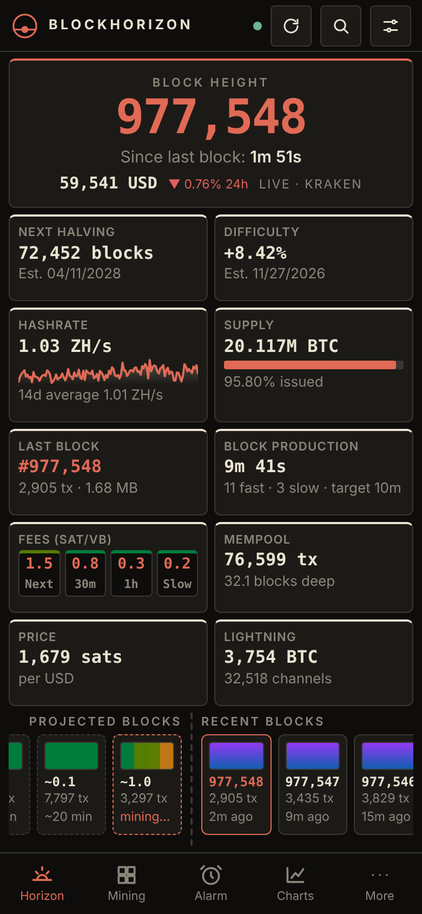

# BLOCKHORIZON

**A calm, live Bitcoin dashboard where time is measured in blocks.**

### [→ Open the app](https://random21m.github.io/BLOCKHORIZON/)

No accounts, no ads, no tracking, nothing to install (though you can). Free public data, in 8 languages, and it works offline.



When a block is mined, you see it happen: the blocks glide one slot along and the new one slides in.



| On a phone | History charts | On your own site |
|---|---|---|
|  |  |  |

## What it shows

BLOCKHORIZON is built around one idea: in Bitcoin, time is measured in blocks. The block height counts up; everything else counts down to the next block.

**The dashboard** (everything on one screen, no scrolling)
- Live block height, time since the last block, and the price streamed from Kraken, with the 24 h change
- Next halving (blocks to go, estimated date, reward) and supply issued
- Difficulty adjustment (progress, expected and previous change), hashrate with 7/14/30/90-day averages, block production against the 10-minute target
- Last block with its mining pool, fees, mempool (count, depth, inflow), and the projected and recent blocks, coloured like mempool.space
- Sats per unit in 7 currencies, Moscow time, market cap, Lightning network capacity

**More pages**
- **Mining:** watch the next block being built and mined, live. Every waiting transaction in it is a square, sized by its size and coloured by its fee rate; new ones drop in as they arrive, and when the block is found it turns purple and slides away while the next one starts to fill. Beside it: hashes tried so far, a stream of tries against the target, the chance it is found in the next minutes, what is in it (fees, reward) and which pool is likely to find it. Follow your own transaction: paste its ID (or tap its square, or use the link on its transaction page) and it is outlined in the block, with where it stands, until the moment it is mined. A bell button turns on the sound for each block found
- **Your block:** pick a day that matters (a birthday, your first bitcoin) and see the block mined that day, how many blocks have passed since, the next milestone, the reward and price back then, and save it as an image to share
- **Clock:** just the height, time since the last block and the price, as large as the screen allows, with the screen kept awake (for a spare screen or an old tablet)
- **Charts:** a live trading chart: BTC candlesticks from Kraken in your currency, 1 minute to 1 week candles, the newest moving with every trade. Volume, EMA 20, SMA 50, SMA 200, Bollinger Bands, RSI and MACD; a crosshair with open, high, low and close; horizontal and trend lines (kept per currency); price alerts set by clicking the chart; the live order book (checked against Kraken's checksum) and recent trades beside it; zoom and scroll by mouse, touch or keyboard; full screen. Below it: price, hashrate, difficulty and median fee over 1 month, 1 year or all time
- **Alarm:** a sound and a message when the chain reaches a block height, when bitcoin reaches a price, or when fees drop to your limit (with a system notification in the background, if you allow it)
- **Calculator:** sats ⇄ fiat, block height ⇄ date, and what a payment costs right now at each fee level
- **Search:** any block by height or date, any transaction by ID (confirmations, fee, or its place in the queue), with shareable links
- Halving replay, chain calendar, glossary, and a Watch page of Bitcoin channels

**Everywhere**
- Dark, light or automatic; English, German, Spanish, French, Portuguese, Italian, Dutch and Turkish; your currency, time and date format
- Accessible: keyboard-friendly, screen-reader labels, and checked with axe-core on every page in both themes as part of the tests
- Calm by design: flat, no flashing, no glow, and nothing moves if you turn on reduce motion

## Install it as an app

Open https://random21m.github.io/BLOCKHORIZON/ and you are already using it. Installed, it opens in its own window, works offline with the last values it saw, and updates itself. Long-press its icon for shortcuts to Clock, Alarm, Charts and Search.

| Where | How |
|---|---|
| **iPhone / iPad (Safari)** | Tap the Share button, then **Add to Home Screen**, then **Add**. |
| **Android (Chrome)** | Tap the menu (three dots), then **Install app** (or **Add to Home screen**). |
| **Windows / Mac / Linux (Chrome or Edge)** | Click the install icon at the right end of the address bar, or open the menu and choose **Install BLOCKHORIZON**. |
| **Mac (Safari 17 or newer)** | **File**, then **Add to Dock**. |
| **Firefox on desktop** | Firefox cannot install web apps. Bookmark the page instead; everything else works. |

Settings (currency, language, time format, theme, sounds) are kept only in your own browser. To remove the app, uninstall it like any other app or clear the site data.

## Put it on your site

Show the live block height, the halving countdown or the price on your own website or blog with one line of HTML. In the app, open **About → Embed on your site**, pick what to show, and copy the code. For example:

```html
<iframe src="https://random21m.github.io/BLOCKHORIZON/embed.html?show=height" width="320" height="120" style="border:0" title="BLOCKHORIZON: Block height" loading="lazy"></iframe>
```

Options: `show=height|halving|price|mining` (`mining` draws a small picture of the block being mined; give it `height="150"`), `theme=auto|dark|light`, `lang=en|de|es|fr|pt|it|nl|tr`, and `cur=USD|EUR|GBP|CAD|CHF|AUD|JPY` for the price. The widget updates itself and links back to the app.

## Privacy

Your browser asks the public mempool.space API for block, fee and mempool data, and Kraken's public feed for the price (plus Kraken's public API for past candles on the trading chart). Nothing else is contacted, there are no cookies or analytics, and nothing about you is stored anywhere but your own browser. Details: [privacy.html](https://random21m.github.io/BLOCKHORIZON/privacy.html).

## Run your own copy

There is nothing to build: the site is plain static files, so any static host works (served over HTTPS, or from `localhost`, so the offline mode can start).

- **On your computer:** clone this repository, run `python3 -m http.server 8080` in it, and open http://localhost:8080.
- **On GitHub Pages:** fork the repository, open **Settings, Pages** and set **Source** to **GitHub Actions**. The included workflow publishes the site on every push to `main` (you can also start it from the **Actions** tab).
- **Anywhere else:** upload `index.html`, `embed.html`, `embed.css`, `style.css`, `sw.js`, `manifest.webmanifest`, `privacy.html`, `.nojekyll` and the `icons`, `src` and `docs` folders. Paths are relative, so a sub-folder works too.
- **Link previews:** the preview card tags in `index.html` (`og:url`, `og:image`, `canonical`) point at this site's address; change them to yours in a fork.

## Develop and test

```
node --test tests/lib.test.mjs     # unit tests on recorded API responses (tests/fixtures)
node tests/smoke.mjs               # Playwright browser checks with the API mocked
python3 -m http.server 8080        # then open http://localhost:8080
```

No build step and no dependencies. The accessibility check in the browser tests runs when `axe-core` is installed (`npm install --no-save axe-core`), as it is in CI.

Code layout (`src/`): `app.js` routing, live repaint and start-up · `state.js` settings and shared state · `data.js` data feeds, block alarms and fee alerts · `ui.js` tiles, charts and other building blocks · `view-dash.js` dashboard and clock · `view-chain.js` block and transaction pages · `view-tools.js` alarm and calculator · `view-info.js` replay, calendar, glossary, watch, about · `view-charts.js` history charts · `trade-chart.js`, `trade-side.js` the live trading chart, order book and trades · `view-my.js` Your block · `view-mining.js`, `block-scene.js` the Mining page and its live block picture · `arrival.js` the block arrival animation · `embed.js` the embeddable widget · `modals.js` search and settings · `lib.js` pure helpers (unit-tested) · `api.js`, `price.js` network · `i18n.js`, `strings.js`, `content.js`, `content-i18n.js` texts.

Version 0.13.1. Not built yet: an art gallery, conference listings and chain-state totals (addresses, UTXOs, disk size), for lack of a free, trustworthy public source.

## Support

If BLOCKHORIZON is useful to you, you can send a tip over Lightning:


`npub1vj8zjhnmkhekv93e2xmrz7kfwuxq25vrzw53u4dqhwd2lp5smvks3mwu2n@npub.cash`

(An npub.cash Lightning address: scan the QR code or paste the address into any Lightning wallet.)
